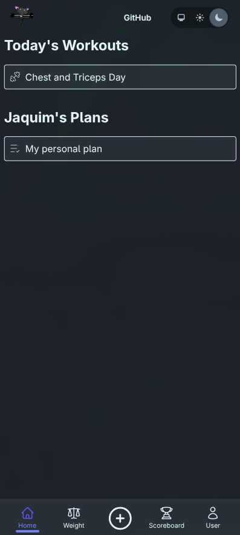
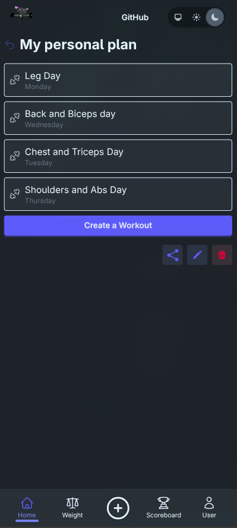
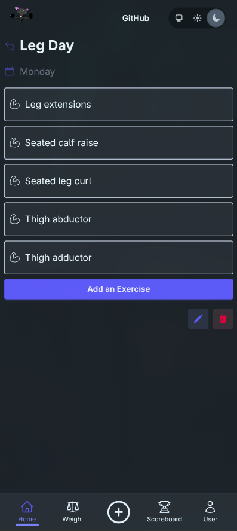
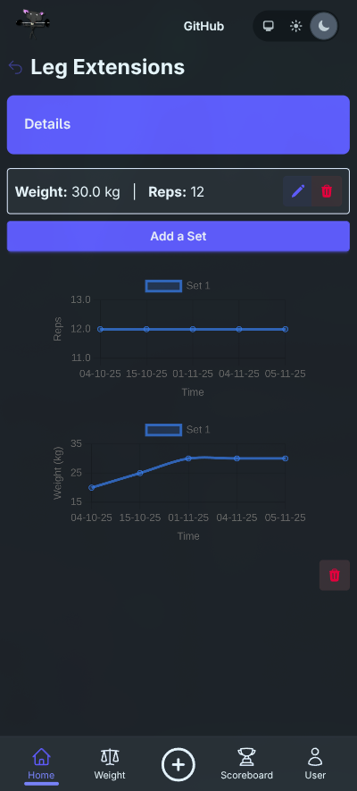
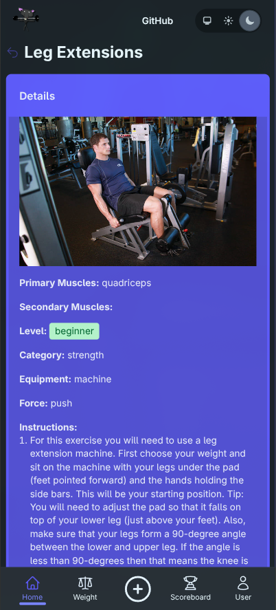
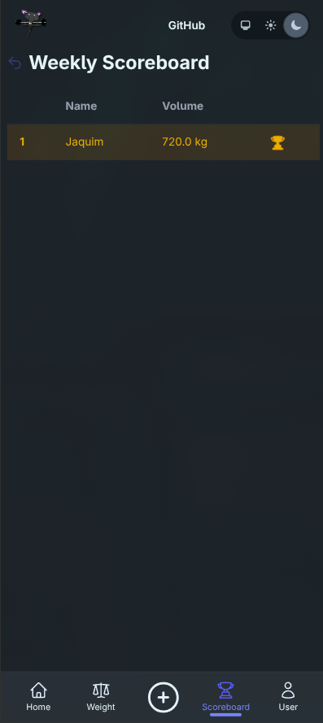
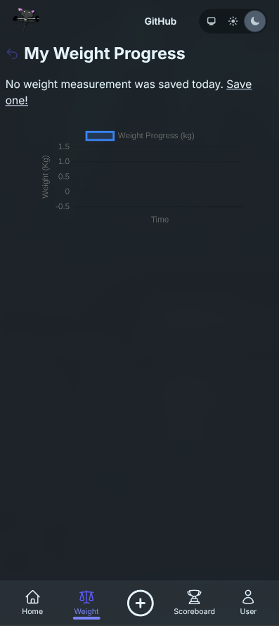

<h2 align="center">Gymrat - Fitness Tracking App</h2>

## What is Gymrat

Gymrat is your ultimate fitness companion! This web application is designed to help you track your workouts, monitor your progress, and stay motivated on your fitness journey. Whether you're a seasoned athlete or just starting out, Gymrat provides the tools you need to achieve your fitness goals.

Key features include:
- Comprehensive workout tracking
- Progress monitoring and analytics
- Weight tracking
- Leaderboards
- Customizable workout plans

Stay tuned for more updates and features to enhance your fitness experience!

### Real user monitoring

Production can send browser performance, errors and session replay to the
homelab OpenObserve instance. Set `OPENOBSERVE_RUM_TOKEN` to enable it. The
browser posts only to Gymrat's `/rum/v1/default/rum` and `/rum/v1/default/replay`
paths; the server forwards those batches to OpenObserve using the RUM-only token.
The token is never put in the page. This endpoint plug runs before the router
and parsers so replay's raw multipart payload is preserved; no browser session
cookies are forwarded.

Replay is sampled at 100% when enabled, with page text and form inputs masked.
No Gymrat user identity is attached, and automatic click-label tracking is off.
The SDK is not started on one-time login or email-confirmation links, or pages
with a query or fragment; replay stops before navigating to such a URL. RUM
event URLs strip query strings and fragments and redact authentication tokens.
OpenObserve retains anonymous session, device and performance metadata.

To start your Phoenix server:

* Run `mix setup` to install and setup dependencies
* Start Phoenix endpoint with `mix phx.server` or inside IEx with `iex -S mix phx.server`

Now you can visit [`localhost:4000`](http://localhost:4000) from your browser.
